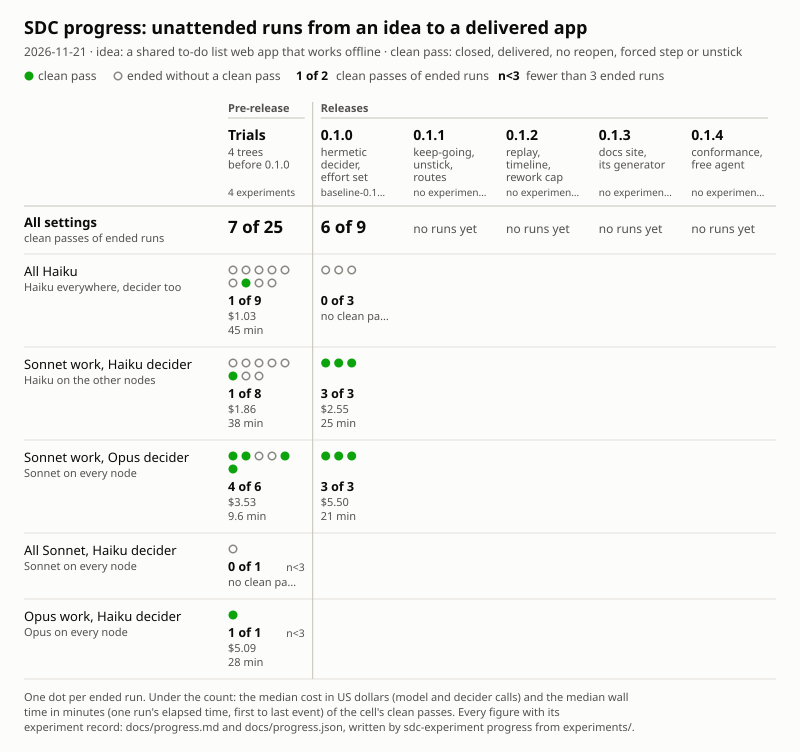

<div align="center">

<picture>
  <source media="(prefers-color-scheme: dark)" srcset="docs/img/runbook-logo-dark.svg">
  
</picture>

Agentic runbooks: a fixed, checked way to handle a case.

[Docs](https://beyond10x.github.io/runbook/) ·
[How it works](https://beyond10x.github.io/runbook/docs/) ·
[Evaluation](https://beyond10x.github.io/runbook/evaluation) ·
[Releases](https://github.com/beyond10x/runbook/releases) ·
[Changelog](CHANGELOG.md)

</div>

## What it is

A runbook is a fixed, checked way to handle a case. A program decides the next step from recorded
facts; a model carries out single steps. The first runbook is the software delivery cycle (SDC):
it takes an idea to a built, tested product. Other runbooks are planned, not built: incident
handling, investigations and ticket triage.

Runbook is a prototype that runs on [Canon](https://github.com/beyond10x/canon) protocols.

## Progress



How often one idea runs with no person to a closed, delivered app, per release and model setting.
Each dot is one run. Every figure, its experiment and its limits are in
[docs/progress.md](docs/progress.md) and on the
[evaluation page](https://beyond10x.github.io/runbook/evaluation). The chart is written by
`sdc-experiment progress`; how an entry is added: [docs/improving.md](docs/improving.md).

## How it works

- **Eight stages.** An idea goes through idea, intake, direction, epic, spec, plan, story and
  release. Each stage is a Canon `protocol/1` case with child cases.
  [The flow](https://beyond10x.github.io/runbook/docs/flow)
- **No stored phase.** The stage is derived from facts: files in the case's repository and
  recorded check results.
  [The flow](https://beyond10x.github.io/runbook/docs/flow)
- **One runtime.** `runbook run` runs one case tree through Loom. It reads Canon's decision for the case, runs the
  tool bound to one admissible action, records the result as Canon evidence and evaluates again.
  [The LLM is not the runtime](https://beyond10x.github.io/runbook/llm-is-not-the-runtime)
- **The model is an executor.** An LLM only carries out one action. Its output is an artifact
  revision, never evidence and never the next state.
  [Context](https://beyond10x.github.io/runbook/docs/context)
- **People decide what is theirs.** A decision that belongs to a person stops the run.
  [docs/decisions.md](docs/decisions.md)
- **Built on layers.** Canon gives the semantics; Loom gives the runtime.
  [What it is built on](https://beyond10x.github.io/runbook/docs/built-on)
  and [docs/layers.md](docs/layers.md)

Every protocol drawn from its YAML is in the
[protocol browser](https://beyond10x.github.io/runbook/protocols). Start in the repository with
[docs/phases.md](docs/phases.md), [docs/loom-run.md](docs/loom-run.md) and
[docs/orchestration.md](docs/orchestration.md).

## Install the plugin

The repository is also a Claude Code and Codex plugin, `runbook`, with skills for building,
recording and hardening a runbook. In Claude Code:

```console
/plugin marketplace add beyond10x/runbook
/plugin install runbook@runbook
```

The skills and what each needs: [plugin/README.md](plugin/README.md).

## Try it

Canon is a library of the `runbook` crate (the pin is `runbook/Cargo.lock`); no `canon` binary is
installed. It needs Rust, `jq`, `yq`, and Node 22 for the live view in `ui/`. Build `runbook` and
the programs it runs once, in the repository root:

```console
(cd driver && cargo build --locked --bins)
(cd runbook && cargo build --locked --bin runbook)
```

The dry run uses an idea text you give it (`--intake`) and stub executors that write the
artifacts, prints every LLM command and runs none, with scripted approvals. It is `runbook run`
(the binary is `runbook/target/debug/runbook`, or `runbook` when it is on `PATH`):

```console
runbook init
runbook run sdc --intake idea.txt --dry
```

`runbook init` writes this `runbook.toml` (mode 600, no comment) into the working directory; the
binary finds it there and in every directory below it:

```toml runbook.toml
runs_dir = "runs"
confinement = "substrate"
max_wall_seconds = 3600
cap_micro_usd = 5000000
max_llm_calls = 200
```

`runbook config` prints every value of a run and the file or option it comes from. The run's name is
generated and printed; any option of `runbook run` still wins over the file. The options and the file's
keys are in [docs/loom-run.md](docs/loom-run.md). The scripted checks and a real run: [Run it](https://beyond10x.github.io/runbook/docs/run-it).

## Repository layout

| Path | Holds |
|---|---|
| `protocol/` | The eight SDC protocols and `sdc-bugfix` |
| `cases/` | Fixture cases with expected decisions, run by `scripts/evaluate-cases.sh` |
| `driver/` | The Rust crate `sdc-tools`: the programs the bindings run and the tools around runs, with the tool bindings in `driver/examples/sdc/` ([docs/driver.md](docs/driver.md)) |
| `runbook/` | `runbook`, the command people type: `run`, `runs`, `decide`, `test`, `check`, `serve`, `mcp`, `doctor`, `list`, `parity`, `canon` ([docs/cli.md](docs/cli.md), [docs/loom-run.md](docs/loom-run.md)) |
| `watch/` | `sdc-watch`: file changes of a run |
| `goals/` | `sdc-goals`: checks of `sdc.goals/1` documents ([docs/requester.md](docs/requester.md)) |
| `ui/` | A live web view of a run |
| `decision/`, `ess/`, `tools/` | The decision contract, its ESS specification and its shell tools |
| `eval/` | Eval runner, adversaries and personas |
| `experiments/` | Experiment records, run summaries and reports |
| `website/` | The documentation site; its protocol data is written by `sdc-protocol-site` |
| `docs/` | Design notes, results and release notes |
| `scripts/` | Check and evaluate scripts |
| `plugin/`, `.claude-plugin/` | The `runbook` plugin (the skills `workflow-builder`, `harden` and `record`) and its marketplace |
| `.engineering/planning/` | The planning store (AEP) |

Recorded runs (`runs/`) are not in this repository. Agents: [AGENTS.md](AGENTS.md).

## Status

A prototype. No interface is stable. Releases are source releases at bare-version tags such as
`0.8.0`; nothing is published to crates.io. The latest is 0.8.0 (2026-11-23).

- Notes per release: [CHANGELOG.md](CHANGELOG.md), [docs/releases/](docs/releases/) and
  [docs/releasing.md](docs/releasing.md).
- New in 0.8.0 over 0.7.0 (nothing is unreleased): the run inspector has a Products tab that lists the
  files a step left under `work/` and shows one as text, Loom `c9b4c177` is linked (a model node that
  was not called no longer counts against `budget.max_runs`), the bindings state their exits
  (`exits.error`, `exits.not_called`; `sdc-node` exits 79 where it prints "not called"), and `runbook
  test` takes `--cycle-timeout` and `--list`. No evaluation run was made on this code
  ([docs/releases/0.8.0.md](docs/releases/0.8.0.md)).
- New in 0.7.0 over 0.6.0: the old driver runtime is deleted (`sdc-drive`
  and the trial, cycle and watch scripts are gone; a run is `runbook run`, the package `sdc-drive`
  is `sdc-tools`), a refusal of Loom ends a run `refused` with exit 12 and a named `cause`, and
  `runbook test` takes `--workers` and `--only` through Loom's selection, and the daemon refuses a
  `submit-run` that names a missing session as `no-session` before `below-floor`. No evaluation run was
  made on this code ([docs/releases/0.7.0.md](docs/releases/0.7.0.md)).
- New in 0.6.0 over 0.5.0 (nothing is unreleased): `runbook run` routes decisions by autonomy level
  from `tools/autonomy-levels.json` and `runbook run --recorded <source>` re-drives a case tree from a
  recording, `runbook canon` runs the linked Canon library (`runbook doctor` needs no `canon`
  binary), and the run inspector is read-only; its acts and the options `--write`, `--write-only` and
  `--principal` are gone. The three evaluation runs of record `parity-loom-strong-4` delivered 0 of 3
  ([docs/releases/0.6.0.md](docs/releases/0.6.0.md)).
- New in 0.5.0 over 0.4.1: `runbook run <runbook>` runs a case in process on
  the Loom engine and the command `runbook loom-run` is gone, `runbook test <suite>` runs a tree
  suite, the decider and every model node are Rust programs, and `sdc-experiment run` starts runs
  only with `runbook run`; the replay options of `runbook run` are refused and no measured run has
  used this tree ([docs/releases/0.5.0.md](docs/releases/0.5.0.md)).
- New in 0.4.1 over 0.4.0: a fix (a model step of `runbook loom-run` that
  started no adapter costs nothing), the ESS specification and the product checks on ESS 0.97.3 with
  the daemon's synthesized suite committed, the reference check `sdc-check-unreferenced`, the two
  evaluation tools reading a loom-run directory, and UI test children that end with their parent; no
  protocol or behaviour change ([docs/releases/0.4.1.md](docs/releases/0.4.1.md)).
- New in 0.4.0 over 0.3.1: the daemon (`runbook serve`, its HTTP API, event
  streams, MCP and an embedded page, on a stub runtime that runs no real case) with `runbook run
  --detach`, `runbook runs` and `runbook decide` as its client, and `runbook loom-run`, which runs
  one case on a pinned `b10x-loom` binary
  ([docs/releases/0.4.0.md](docs/releases/0.4.0.md)).
- Three trials are written up: [Trial 1](docs/trial-1.md) (a real LLM; round 1 stopped, as
  designed, on three scope-changing questions for a person), [Trial 2](docs/trial-2.md) (a
  late-found ambiguity and the loop that repairs it; verified with stub executors, the real-LLM
  run is in its run notes) and [Trial 3](docs/trial-3.md) (autopilot runs of the to-do idea:
  five of the eight runs of the batch tree at `acd6f12` passed; the limits are in
  [docs/releases/0.1.0.md](docs/releases/0.1.0.md)).

## Licence

Apache-2.0, see [LICENSE](LICENSE).
