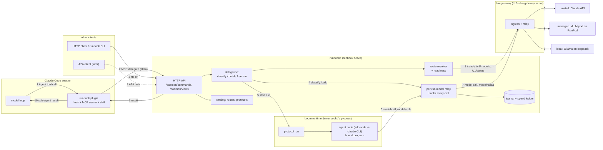
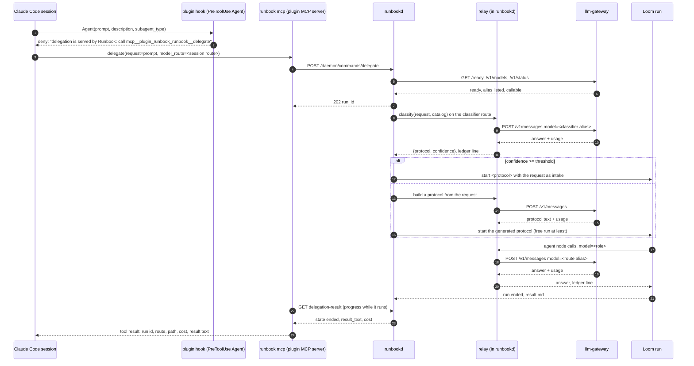

# Model routes and delegation: the architecture of the stack

Status: design, accepted by the operator 2026-11-25; being built (built: section 1, the relay of sections 4, 5 and 11, section 2, and section 3 with the wake, which ships off). The operator settled D-1 to D-7 and the gateway's C1 to C4 on
2026-11-25 (end of the document).

## The goal

The operator's ask (2026-11-25): the LLM gateway, with models on a RunPod pod, a hosted Claude and a local Ollama
behind it, is wired into Runbook, and the Runbook daemon (`runbook serve`, runbookd) dispatches runs on a chosen model
route. The done-line, in the operator's words: any Claude session on this machine "can dispatch regular agent runs via
runbook by submitting a request with a model route id", with an endpoint to "explore/enumerate the available stuff",
and a plugin that replaces the session's delegation tool and dispatches the agent run on Runbook. A request either
runs an available protocol it was classified to with high confidence, or a protocol built "on the fly" from the
request text.

### Acceptance of the whole

From the consumer that runs Runbook on this machine (2026-11-25). Each is a test that fails before and passes after,
with a stand-in gateway: no live model, no pod, no paid run.

1. A run names a route; its calls reach only that route's gateway endpoint; each call's usage (route, endpoint,
   model, input and output tokens) is booked in the run's record and spend line.
2. A route that is down fails the run loudly: one line naming the route and the setting that chose it, a non-zero
   exit, no fallback to another route, nothing booked as a success.
3. The daemon takes the route as a submit field; an unknown route is refused at submit with the list of known ones;
   a route with a declared price books a cost from tokens, not a reservation.
4. An enumerate endpoint (HTTP and MCP) lists the routes (id, status, wires) and the protocols (id, one-line
   purpose, inputs).
5. A delegation (HTTP and MCP) with request text and a route id returns a run id at once; the run's result (state,
   outcome, products) is then readable by that id.
6. A request that matches a known protocol at high confidence runs it; one that does not runs a generated protocol;
   the path, the protocol id and the confidence are recorded and shown by `read_run`.
7. A headless Claude Code session with the Runbook plugin enabled delegates a sub-agent task through the plugin and
   gets the run's result back; its own model endpoint is a stand-in speaking the Messages wire for one tool-use turn.

## The components



### The arrows

1. **Session → plugin.** The model calls the Agent tool (`prompt`, `description`, `subagent_type`). The plugin's
   PreToolUse hook takes it (Part two). Failure: none at this arrow; the hook always answers.
2. **Client → runbookd: delegate.** `{request, model_route, protocol?, workspace?, settings?, idempotency_key?,
   session_id}`; the MCP tool `delegate` and `POST /daemon/commands/delegate` carry the same members. Answer: 202
   `{run_id, location}` at once. Failure: 422 `route-refused` (unknown route, with the list of declared routes;
   a route a protocol does not admit), 503 `route-unavailable` (gateway not ready), and the refusals of
   `submit-run` today (`IntakeTooLarge`, `ContextOutsideRoots`, `NoSuchSession`, `BelowConfinementFloor`).
3. **runbookd → gateway: readiness.** `GET /ready`; `GET /v1/models` (alias, wires, `max_model_len`); `GET
   /v1/status` (`callable`, `phase`) once the gateway has it, `GET /v1/models/{alias}/status` until then. Failure:
   no answer or 503 refuses the submit `route-unavailable`; an alias not listed refuses it `route-refused`; a
   route not callable makes the run wait (`waiting-for-route`) and end `stopped: route` past its wait.
4. **runbookd → relay → gateway: classify and build.** Two model calls of the delegation itself, on
   `route_policy.classifier`, booked like any call. Failure: a failed call ends the run `failed: route-unavailable`
   naming the route; an answer that is not the expected JSON ends it `failed: classifier-answer`.
5. **runbookd → Loom: start the run.** The chosen or generated protocol, the request as the intake, the run's route
   table (role → route). Failure: a protocol the loader refuses ends the run `failed: protocol-refused` with the
   loader's line.
6. **Agent node or program → relay.** The run's model processes reach the relay, never the gateway: a file in the
   run's private directory names the relay's address, a token for this run, the route and the alias (section 11).
   The request is the gateway's wire (`/v1/messages`, `/v1/chat/completions`, `/v1/responses`). Failure: a call
   past the run's caps is refused `429 cap-reached`; an unknown run token `401`.
7. **Relay → gateway.** The same request with `model` set to the route's alias and the gateway's credential added;
   the answer streams back unchanged; the relay reads `usage` from it (and `x-llm-gateway-call` once the gateway
   sends it) and writes one ledger line. Failure: the gateway's refusal is passed back unchanged and booked; the
   run ends as the step ends, and a step that failed names the call (`route-unavailable` or `call-refused`, the
   route); a refusal of the route by the gateway and its spend ceiling fail the step at once (section 4). The relay
   never sends the call to another route.
8. **Gateway → upstream.** The gateway's own arrow (section "The model gateway"). A call to a stopped pod starts
   nothing once the gateway's `start_on_request` is false (its story `a-call-starts-no-pod`).
9. **runbookd → client: result.** `GET /daemon/views/delegation-result?run_id=<id>` and the MCP tool
   `delegation_result`: `{state, outcome, result_text, products, route, path, protocol, confidence, tokens,
   cost_micro_usd, cost_known}`. Failure: 404 for an unknown run.
10. **Plugin → session.** The run's `result_text` (bounded) and one header line (run id, route, path, cost) become the
    tool result the model sees in place of the sub-agent's answer. A failed run is a tool error naming the cause.

### One delegation, end to end



### Which repository owns what

- **runbook** (`beyond10x/runbook`): runbookd's route declaration, resolver and readiness; the relay and its
  booking; the delegation endpoint, classify, build and free run; the catalog; the daemon page; `runbook mcp`'s new
  tools; `runbook delegate`; the Claude Code plugin (its `plugin/` directory, today skills only).
- **llm-gateway** (`beyond10x/llm-gateway`): route kinds (managed, hosted, Bedrock, local Ollama), status for every
  route, a call that starts no pod, the call id and record. Its section below is the gateway maintainer's.
- **loom** (`beyond10x/loom`): runs the protocol. Nothing new is asked of it: the route reaches the run's model
  processes through the run's private directory, as the gateway file does today.
- **a2a** (`beyond10x/a2a`): its server crate is the later A2A face of the delegation (a draft story in runbook).
- **The consumer's repository**: its acceptance tests (above), and it drops its own route words when the daemon takes
  the route.

## Runbook's part

### 1. Routes are declared by the daemon's operator

The daemon's `runbook.toml` (or the file `--config` names) declares its gateways and routes. Only this file holds
an address, a token file and a price.

```toml
[routes.qwen]
gateway = "default"           # a [gateways.<name>] table below
model = "qwen"                # the gateway's alias, as /v1/models lists it
kind = "managed"              # "managed" (gateway-owned pod), "hosted" (fixed upstream) or "local" (Ollama)
start_wait_seconds = 600      # how long a run waits for phase ready before it ends `stopped: route`
price_in_micro_usd_per_mtok = 0   # optional: what the ledger books per million input tokens
price_out_micro_usd_per_mtok = 0  # optional: per million output tokens
wake_on_submit = false        # managed only; true is refused unless the cap and the cost below are above 0 (D-5)
wake_daily_cap_micro_usd = 0  # managed only; the most wakes may book per day
wake_cost_micro_usd = 0       # managed only; what one wake books against that cap

[routes.claude]
gateway = "default"
model = "claude"
kind = "hosted"

[routes.local-qwen]
gateway = "default"
model = "qwen-local"
kind = "local"

[gateways.default]
base_url = "http://127.0.0.1:<port>"
token_file = "<path>"          # the owner credential; status reads need it even when wire paths take none

[route_policy]
default = "claude"             # the route of a run that names none; absent: a run must name one
classifier = "claude"          # the route of the classify and build calls of a delegation (section 9)
```

- `[gateways.<name>]` replaces the single `[gateway]` table; `[gateway]` stays accepted as `[gateways.default]`
  for one release, then is refused by name.
- A route names an alias, never an upstream URL, a pod id or a key: those stay in the gateway's own document.
- A non-loopback `base_url` is the operator's choice, as for `[gateway]` today.

### 2. Which route a run uses

The operator's rules (2026-11-25): "generally, it must all be allowed, but it should be just configurable per protocol
or per run config"; and on D-1, routes are declared "both" by the daemon and by a protocol.

- **Allowed by default:** every route the daemon declares may serve every runbook.
- **A protocol declares the routes it needs.** A runbook may carry a file of Runbook's own beside its bindings,
  `<runbook>.routes.yaml`, with one entry per role (`writer`, `review`, ...). It is not part of the bindings:
  those are Loom's `loom.bindings/1` document, which stays unchanged.

  ```yaml
  format: runbook.routes/1
  model_routes:
    writer: {route: qwen}                        # a daemon route by name
    review: {needs: {wire: messages, min_context: 100000, tool_calling: true}}
  routes_allowed: [qwen, claude, local-qwen]     # optional: narrows which daemon routes may serve this runbook
  ```

  An entry names a daemon route, or states requirements (`wire`, `min_context`, `tool_calling`, `kind`) that a
  daemon route must meet. A protocol never names an address, a token, a price or an alias the daemon does not
  serve.
- **Admission.** When the daemon loads a runbook it matches each entry against its declared routes: a named route
  must be declared; requirements are met by the run's or the policy's route when it meets them, else by the one
  declared route that meets them; none or several is a refusal. A runbook whose entries cannot be admitted is listed
  with the reason and refused at submit: 422 `route-refused`, naming the runbook, the role and the unmet requirement.
  The facts a requirement is checked against come from `/v1/models` (`wires`, `max_model_len`) and the route's
  declaration.

  Built (`story:protocol-declares-the-routes-it-needs`; `docs/daemon-api.md`, "The route of a run"): the file is
  `bindings/<runbook>.routes.yaml`, read at each `submit-run`, each delegation that names the runbook as its
  protocol, and each delegation whose runbook the classifier picks, once it is picked and before its first model call
  (a refusal there ends the run `FailedToStart` with `route-refused: ` and the same reason; the routes the entries give
  then take the readiness check of section 3, a route that cannot answer within its wait ends the run `FailedToStart`
  with `route-unavailable: `, and the run record names the routes it took). Requirements the run's route misses are
  met by `route_policy.default` when it meets them. No role's name starts with `runbook-` (section 11). A role the run names takes the run's route, which must be allowed and meet the role's needs; a role it does
  not name takes the entry's route; an entry for the role `default` comes before `route_policy.default`. A call of a
  role the runbook chose is booked with the source `protocol`.
- **Per run:** a submit may name `model_route = "<name>"` and per role `model_routes.<role>`. It names a declared
  route by name only; an address, a token or an alias is refused by name.
- **Precedence:** the run's word, then the protocol's, then `route_policy.default`. A route outside the protocol's
  `routes_allowed`, or one that misses the role's requirements, is refused before the run starts (422
  `route-refused`, naming the route and the rule that refused it).
- `runbook run` reads the same tables from `runbook.toml` and takes `--model-route <name>`.
- A run's model calls may come from its decider or from its programs (section 11: the route file goes to every model
  process of a run on a route, bound programs included). A run takes a route, named or `[route_policy] default`, only
  when it has a model step (the operator, 2026-11-27: "A: route only for model steps";
  `story:the-default-route-wakes-for-runs-without-a-model-call`). It has one when, as the daemon reads at submit:
  - its decider is `model` above `A0`; or
  - a program the run's runner starts for its bindings (the root's, or a child's that an `open` action names) is an
    agent node (its first word is `sdc-node`). Every program the runner starts counts: an action's `executor.argv`,
    its `arguments_from` and its `handoff_when` check, for Loom starts each through the runner, which reserves its
    budget and, on a route, hands it the route file; or
  - such a program reserves a per-call budget above 0, read as the run reserves it as it starts the program
    (`budget::Reserves::of`): the budget its arguments name (`--max-budget-usd`), else `max_budget_usd` of the action
    whose `executor.argv` or `arguments_from` it is, else of its file, else the largest budget of the runbook.
    `max_budget_usd: 0` (or `--max-budget-usd 0`) is a program that calls no model (`runbook/src/budget.rs`,
    `calls_a_model`). Bindings that cannot be read, a child file that cannot be read or parsed among them, or that a
    run is refused for at load, count as a model step (the run is refused at load all the same).

  Route entries (`bindings/<runbook>.routes.yaml`) make no model step: they say which route a model step takes. A run
  with no model step (a person's actions only, or programs whose budget is 0, and a decider that is no model) takes
  no route: the default route is not applied to it, no wake is sent or booked for it, it does not wait for a route and
  its programs get no route file. A submit for it that names a route (`model_route`, `model_routes.<role>`) is
  admitted all the same and takes no route either: consumers name their route in every submit, and their runs without
  a model step must not be refused (the coordinator's decision of 2026-11-27, which follows the operator's). Its first
  event `runbook.submitted` names what the submit asked for and why it was not taken: `model_route_not_taken`, with
  `model_route`, `model_routes` and `reason` ("the run makes no model call ..."). A name that is not a declared route
  (an address, a token, an alias) is refused as for any run. Only a run whose runbook runs no bound program and no
  agent node, and whose decider is no model above `A0`, is refused `route-refused` when it names a route, the reason
  naming the member and "the run makes no model call", as before this rule. A run whose model calls come
  from its programs only and that names no route takes a declared `[route_policy] default` only, and only where the
  relay is served (a loopback listener); else it takes none and runs as before routes (built: `docs/daemon-api.md`,
  "The route of a run").

### 3. Before the run starts: the route must be able to answer

At submit, after the route is resolved and before anything is written:

1. `GET <gateway>/ready` answers 200; else the submit is refused `503 route-unavailable` naming the route and
   "gateway not ready".
2. `GET <gateway>/v1/models` lists the alias; else `422 route-refused` "the gateway serves no model `<alias>`".
3. For a `managed` or `local` route, the route's status: `GET /v1/status` (`callable`, `phase`) once the gateway
   serves it, `GET /v1/models/{alias}/status` until then (managed only):
   - `ready`: the run starts.
   - any other phase: the run is accepted in the state `waiting-for-route`. The daemon reads the status at most once
     every 5 s up to `start_wait_seconds`; on `ready` the run starts; past the wait it ends `stopped: route` naming
     the last phase. No call goes to the route while it waits.
4. **Wake (D-5: built, off).** With `wake_on_submit = true` the daemon sends one `POST /v1/models/{alias}/wake`
   when it accepts a run on a stopped managed route, and books `wake_cost_micro_usd` against
   `wake_daily_cap_micro_usd` for the day. `wake_on_submit = true` without a cap above 0 is refused at start by
   name, and so is one without a `wake_cost_micro_usd` above 0 (a wake that books nothing never meets the cap). A wake the day's cap does not cover is not sent: the run waits as in 3 and the run record says
   "wake cap reached". A run within the wait of a wake sent for the same route joins it and sends and books none. A `spend-ceiling` answer ends the run `stopped: route` naming the ceiling, and so it ends every run that joined that wake. A `wake_cost_micro_usd` above the cap is refused at start by name. The shipped
   default is off; the pod is started by a person until the operator sets the cap. Built: `docs/daemon-api.md`, "The wake of a managed route".
5. For a `hosted` route the daemon sends no model call to probe it (a probe would spend). The run starts; a failing
   upstream shows as a failed call (section 4). A hosted route's `callable` of `/v1/status` is shown in the view `routes`
   and holds no run: the gateway reads it from the upstream's model list, and an upstream that answers 404 there reads
   not callable though its calls work.
6. `waiting-for-route` is a new state of the run and `stopped: route` a new end: both enter the daemon's ESS
   lifecycle, and its conformance suites are regenerated.
7. `runbook run --model-route` does not wait: a managed or local route that is not callable refuses the run with
   the route, its phase and the setting that chose it, and exit 2. Only the daemon waits.

### 4. While the run runs: one route per call, no silent fallback

- Every model call of the run (agent nodes, the decider, a bound program that starts a model client, and the
  delegation's classify and build calls) goes through the run's relay in runbookd (section 11), which sends it to
  the route's gateway with the route's alias as its model.
- The relay sees the gateway's answer, so it names the cause: a connection refused, `model-unknown`,
  `model-stopped`, `model-cold-start`, `target-unavailable`, `upstream-failed`, `spend-ceiling` or `unavailable`
  is recorded on the call with the cause `route-unavailable`, the route, the gateway's code, its error text (type
  and message, at most 300 bytes, no header, no token) and the setting that chose the route (run, protocol or
  default). A `4xx` answer that is no refusal of the route by the gateway (an upstream's `invalid_request_error` the
  gateway relayed) is recorded the same way with the cause `call-refused`.
- A failed call does not end the run by itself: the client may retry, as Claude Code does, and the run ends as the
  step ends. A step that exits 0 with its products goes on, the run's record naming the failed calls
  (`runbook.model-calls-failed`); a step that fails names the first failed call as the first cause of the run's
  failure. The protocol decides what a failed step does, as for any failed program; a failed decider call leaves its
  decision open for a person, with that cause on it (story `a-recovered-call-does-not-fail-the-run`). A step whose
  program exits with a status its bindings take as a result (not one their `exits.error` lists) is no failed step
  while the protocol goes on: its failed calls are named, not the run's cause. A failed call booked after its step
  ended (a later start of the same action included) never fails the run, a refusal of the route included: it is named
  under its own step (story `a-call-booked-after-its-step-ended-does-not-fail-the-run`).
- A caller that hangs up on its call ends it at the gateway: the relay closes its request within a second and books
  the call `call-abandoned` (`caller-hung-up`) at what the answer reported so far, else at its reservation; it is no
  failed call (`docs/engine.md`, "A gateway").
- The gateway's refusals of the route (`model-unknown`, `wire-not-served`, `credential-*`) and its `spend-ceiling`
  fail the step at once with the cause `route-unavailable`, whatever its program does after, when they are booked
  while that step runs; one booked after its step ended is a late call (above).
- Runbook never re-sends a call to another route, and never changes the route of a running run.

### 5. Booking and caps

- Every call through a route is one ledger line, written by the relay: run, step, route, alias, gateway call id
  (once the gateway sends one), input and output tokens, and its cost. The relay's line replaces the adapter's own
  `cost_usd` for a routed run: today a call that ended 0 with no `cost_usd` ends the run (`runbook/src/cost.rs`),
  and a gateway alias has no price in the model client's table.
- Cost (D-3): with prices declared on the route, tokens times price (the input price takes the input read from and
  written to the prompt cache, booked in fields of their own beside `input_tokens`); without, `cost_known: false` and
  the call books its reservation (the step's largest while its step runs, else `max_call_micro_usd`), fixed as the
  call is admitted, as the ledger does today for a call of unknown cost. A local route costs 0 unless prices are
  declared; an answer with no usage costs 0 at declared prices and books the reservation on a route without them. A managed pod's hourly cost is the gateway's (its daily and total spend ceilings);
  Runbook books wakes only (section 3).
- The run's `max_llm_calls` and `cap_micro_usd`, and the daemon's daily spend ledger, count these lines. A cap that
  is reached stops the run as today.
- A tool that a program starts and that calls a model through the route file (section 11) is booked by the relay
  like any call. A tool that reaches a model by another path (its own login, its own address) is outside the route
  and unbooked; confinement, not this design, closes that path (D-2).

### 6. What the daemon shows

- The run's header on the daemon page: `route qwen · managed · ready` (or `starting`, `stopped`, `unreachable`),
  and the run state `waiting-for-route` while it waits.
- A **Routes** view (`GET /daemon/views/routes`, and the MCP tool `list_routes`): each declared route with its
  alias, kind, the gateway's readiness and the model's phase (read at most once every 15 s and cached), and today's
  calls and booked spend from the ledger.
- The run record names the route, the alias and the route's source (run, protocol or default).
- Built (story `daemon-page-shows-the-route`; `docs/daemon-api.md`, "The web UI"): the run's header and the Routes
  view of the daemon's page, which reads the view `routes` at most once every 15 s. Today's calls and booked spend
  per route are not in the view `routes` yet, and the page says so.

### 7. Confinement

A run at the confinement level `substrate` cannot reach a gateway on loopback today
(`story:gateway-under-substrate-confinement`, draft). A route serves runs at the level `local` only, and a submit at
`substrate` that needs a route is refused by name (D-4).

### 8. Delegation: one endpoint for an agent run on a route

A **delegation** asks the daemon to do a piece of agent work on a named route:

```json
{"request": "<text>", "model_route": "<route>", "protocol": "<runbook, optional>",
 "workspace": "<absolute path under a context root, optional>", "settings": {}, "idempotency_key": "<optional>"}
```

- HTTP: `POST /daemon/commands/delegate` answers 202 with `run_id`, the path taken (section 9) and the `Location`
  of the run. The run's result: `GET /daemon/views/delegation-result?run_id=<id>` answers the state, and when the
  run has ended its outcome, the final text the run returned (`result.md` of its work directory, bounded to
  1,048,576 bytes), the products list, the route, tokens and cost.
- MCP: `delegate` (the same members; it waits for the end with a progress notification at each step and returns
  the result; past its wait bound it returns the run id and state, and `delegation_result` reads the rest).
- Command line: `runbook delegate --route <r> [--protocol <p>] <request-file>`, a client of the same endpoint.
- A2A: not in this design's waves; a draft story.
- The same refusals as `submit-run` (session, confinement, context roots, intake size), plus `route-refused` and
  `route-unavailable` (sections 2 and 3). A delegation is a run: `cancel-run`, the run views, the events and the
  daemon page work on it unchanged.

### 9. A request becomes a protocol: classify, else build

When the delegation names a `protocol`, that runbook runs with the request as its intake. Otherwise:

1. **Classify.** One model call on `route_policy.classifier` gets the request text and the catalog of runbooks
   the daemon can run (id, title, description, inputs) and answers `{"protocol", "confidence", "inputs"}`. With
   confidence at or above `delegation.classify_threshold` (default 0.8) and inputs the runbook accepts, that
   runbook runs. The answer is a product of the run.
2. **Build.** Otherwise one model call on the same route writes a protocol for the request. The builder composes
   only parts the daemon already has: agent nodes (`sdc-node`) with instructions it writes, and the programs and
   child runbooks of the catalog. It writes no program text. The daemon checks the result with the same loader as a
   shipped runbook; a protocol the loader refuses ends the run `failed: protocol-refused` with the loader's line.
   The generated protocol is a file of the run and is listed among its products.
   Built: each action of a generated protocol runs the free run's agent node (`sdc-node delegation.free`), and an
   action may carry its own instruction text (`instruction` in its bindings), which the daemon writes to
   `work/delegation/steps/<action>.md` and the node reads with `--step` beside the request
   (`instructions/delegation.step.md`). Not built: the programs and child runbooks of the catalog in a generated
   protocol; a builder that names one is refused.
3. **The free run** is the simplest generated protocol and the builder's fallback: one agent node whose
   instruction is the request text, on the delegation's route, in the run's workspace, writing `result.md`.

The run record names the path (`named`, `classified` or `generated`), the classifier's confidence and protocol, the
classifier route, and the digest of a generated protocol. Classify and build calls are booked like any call
(section 5). Every program of a generated protocol runs at the run's confinement level, like any runbook.

### 10. The catalog: what a session may name

`GET /daemon/views/catalog` and MCP `describe_catalog`: the declared routes with kind, wires and status (section 6), the
runbooks with title, description, inputs and their route entries with admission result (section 2), the delegation
members and their limits, and whether classify and build are on (a daemon without `route_policy.classifier` takes
only delegations that name a protocol).

Built (`story:daemon-catalog-lists-what-a-delegation-may-name`; `docs/daemon-api.md`, "The catalog"): the view, the MCP
tool and `runbook catalog`. A runbook's route entries are read from `bindings/<runbook>.routes.yaml`; the catalog
lists their admission against the declared routes and what the gateways listed (`wires`, `max_model_len`,
`tool_calling`); a submit and a delegation that names the runbook are refused by the same admission (`story:protocol-declares-the-routes-it-needs`, section 2). The paths a delegation may
take are listed: `named` and `free`, and on a daemon with a classifier route `classified` and `generated`
(section 9).


### 11. The run's model entry: the relay and the route file

Today a daemon run's agent nodes and bound programs get neither a login nor a gateway (`docs/engine.md`, "A
gateway"); only the decider does. A delegation is agent work, so its agent nodes need a model. This section is the
entry `story:model-entry-for-bound-programs` asked for, and the place every call is booked.

- **The relay.** runbookd serves, on its own loopback listener, `/daemon/relay/<run>/v1/messages`,
  `/v1/chat/completions` and `/v1/responses`. A call names its route by role in `model`: the model the route file
  gives the role (`runbook-writer`, `runbook-default`) or the bare role (`writer`, `review`, or
  `default`), a trailing bracketed suffix a client adds (`runbook-default[1m]`) dropped; the relay looks up the run's route table, refuses a role the run has no route for (`400
  route-refused`), checks the run's caps (`429 cap-reached`, nothing sent), sets `model` to the route's alias, adds
  the gateway's credential, sends the call, streams the answer back unchanged, reads the usage from it (the JSON
  `usage` object, or the usage events of a stream), and writes the ledger line.
- **The route file.** For each run on a route the daemon writes `route.json` (mode 0600) into the run's private
  directory (`$XDG_RUNTIME_DIR/runbook/daemon-<process>-<run>/`, mode 0700) and gives every model process of the
  run its path in `RUNBOOK_ROUTE_FILE`, and nothing else of it:

  ```json
  {"format": "runbook.route/1", "base_url": "http://127.0.0.1:<daemon port>/daemon/relay/<run>",
   "token": "<a token minted for this run>", "routes": {"default": {"route": "qwen", "model": "runbook-default"},
   "review": {"route": "claude", "model": "runbook-review"}}}
  ```

  The token is the run's own, minted at start and void when the run ends; the gateway's credential never leaves
  runbookd. The `claude-cli` adapter sets `ANTHROPIC_BASE_URL` to `base_url` and `ANTHROPIC_AUTH_TOKEN` to the
  token for the `claude` it starts, and the model to the role's `model` (`runbook-<role>`: Claude Code takes a bare
  `default` for an alias of its own and asks for `default[1m]`); a program that starts another model client does the
  same with its own client's settings. The relay takes `runbook-<role>` for the role `<role>` first, else a bare role
  name; a role whose name starts with `runbook-` is refused in a submit and in a runbook's route entries.
- **Who gets the file:** the decider, every agent node (`sdc-node`) and every bound program of a run on a route.
  A program that never calls a model ignores it. The file and its directory go when the run ends.
- `[gateway]` today gives the decider the gateway's own address and token; with routes, the decider takes the
  route file like every other model process, and no process of a run holds the gateway's credential.

## The model gateway (llm-gateway)

Written by the gateway's maintainer for this design (2026-11-25), brought to release 0.25.0 from the gateway team's
report (2026-11-26). Nothing marked [proposed] is built; each is a draft story in `beyond10x/llm-gateway`. "Today"
means release 0.25.0.

### Components

```
client: the dispatcher's daemon, Claude Code, Codex
   |  POST /v1/chat/completions | /v1/responses | /v1/messages, body "model": "<route>"
   v
llm-gateway: one process, one closed TOML deployment document
   |- ingress: probes, load shedding, authentication
   |- relay: route lookup, wire check or translation, hold while a pod starts
   |- target source, one per route kind
   |    |- managed RunPod -> RunPod API (create, stop) -> the pod's vLLM behind the RunPod proxy
   |    |- hosted         -> any upstream by base URL (Anthropic API, a vLLM somebody runs, OpenRouter)
   |    |- Bedrock        -> AWS Bedrock
   |    `- local Ollama   -> an Ollama server on loopback
   `- records: one usage record per call -> log event, counters, dashboard, call store
watchdog: a second process that stops the gateway's own pods when the gateway cannot
```

- The gateway holds every upstream credential (file or OS keychain reference). A client holds at most the gateway's
  owner secret.
- A route is a model alias in the document. All kinds are served side by side under one listener; a changed
  document takes a restart.
- A client names the route in the body's `model` field. No header, no path segment.
- A model is relayed byte for byte on a wire its upstream speaks and translated on the other two (chat, responses,
  messages).

### Route kinds

- Managed RunPod (`[models.<alias>]` + `[providers.<name>] kind = "runpod-vllm"`), today. The gateway creates the
  pod, stops it after `idle_timeout_minutes`, and the watchdog stops it when the gateway is gone. Phases `stopped`,
  `starting`, `ready`, `stopping`. Provider keys `daily_cap_usd` and `total_cap_usd` bound pod starts.
- Hosted (`[hosted.<alias>]`, or a route of an llm routes document), today. Nothing is started or stopped. The
  Claude route is this kind: the messages wire, the gateway's own key or the client's credential forwarded.
- Bedrock (`[hosted.<alias>] kind = "bedrock"`), today.
- Local Ollama, today (release 0.25.0, `story:ollama-route`; kind `ollama` in `GET /v1/status`, a local model
  loaded): its base URL on loopback, the alias mapped to an Ollama model name. The gateway never pulls a model and sends Ollama no request that changes what it stores.

Runbook's route `kind` maps onto these: `managed` is a managed RunPod model, `hosted` is a hosted or Bedrock model,
`local` is a local Ollama model.

### Route list and status

- Today: `GET /v1/models` (no credential) lists every alias with its wires. `GET /v1/models/{alias}/status` and
  `POST /v1/models/{alias}/wake` exist for managed RunPod models only. `/health` and `/ready` describe the process,
  never an upstream.
- Today: `GET /v1/status` is served. For each model it gives `callable`, `phase` and `sub_phase`, for the kinds
  `pod`, `hosted`, `route` and `ollama`. The proposal's document was
  `{"format":"llm-gateway.status/1","models":[{"model","kind","wires","phase","sub_phase","profile","callable"}]}`,
  every model once, alias order; the report names only the three members above, so the rest of that shape is
  *inferred*. [proposed] `GET /v1/models/{alias}/status` answers for every kind but Bedrock.
- Phases:
  - `ready`: a call is relayed.
  - `starting`: a call is held up to the model's `request_hold_seconds`, then `model-cold-start`.
  - `stopped`: nothing is live. Managed pod: the owner's wake starts it. Ollama (`sub_phase` `not-loaded`): the
    first call loads it.
  - `stopping`: a pod owes a stop; nothing starts meanwhile.
  - `unreachable` [new]: the upstream does not serve. `sub_phase`: `no-answer`, `credential-refused`,
    `status-<code>`, and for Ollama `model-not-pulled`.
- `callable` [new]: true when a call sent now would be relayed or held, false when it would be refused. The
  dispatcher's rule is this one boolean.
- How a status is read: managed pod from the gateway's own state, no provider call. Hosted: one `GET <base
  path>/models` with the route's own credential, own deadline, the result reused for a published time, at most one
  probe per route at a time. Ollama: `GET /api/tags` (pulled) and `GET /api/ps` (loaded). A status read starts
  nothing and costs nothing.

### No call starts a pod

- Today the first call to a stopped managed model creates a billed pod.
- [proposed, story:a-call-starts-no-pod] `[models.<alias>] start_on_request`, default `false`: a call to a
  `stopped` or `stopping` model is refused `503 model-stopped` at once and nothing is created. `true` is accepted
  only when the model's provider declares `daily_cap_usd`; otherwise the gateway refuses to start (`config:value`).
- The owner's `POST /v1/models/{alias}/wake` is the one way a person starts a pod through the gateway; it stays
  under the spend check.
- This changes a default and is named as a break in the changelog.

### Call id and usage

- The answer body is the upstream's own, so a client reads the upstream's `usage`. The gateway's usage record
  (model, wire, outcome, refusal, statuses, bytes, duration, tokens) feeds counters and the dashboard.
- Today: the answer of every model call carries the header `x-llm-gateway-call: <id>`, and `GET /v1/calls/{id}`
  answers the record `llm-gateway.call/1` of that call (C4). The proposal's record was
  `{"format":"llm-gateway.call/1","id","state","model","wire","disposition","outcome","refusal","status",
  "target_status","input_tokens","output_tokens","cache_read_tokens","cache_creation_tokens","response_bytes",
  "duration_ms","profile","principal"}`, `state` `in-flight` until the last byte is written, a value that was not
  reported absent (never 0, never an estimate), a published number of ended calls kept and another id `404
  call-unknown`; the report names the format only, so these members are *inferred*.
- A streamed chat answer carries tokens only when the client asked (`stream_options.include_usage`); the gateway
  relays the request unchanged. Runbook's relay sets that option on a streamed chat call it forwards.

### Cost

- Today a model that declares `token_price` gets `cost_usd`, a USD string, in its call record (`GET /v1/calls/{id}`).
  A managed model declares `price_per_hour_usd` for the spend check; the dashboard snapshot has the RunPod account's
  balance and spend rate.
- Runbook prices a call itself, as D-3 says: the price per million tokens declared on its route, else the
  reservation. Runbook does not read the gateway's `cost_usd` yet.

### Refusals a dispatcher meets

Body `{"error":{"code","message"}}`, stable codes.

- `model-unknown` 404: no such route. Fail the run; the route id is wrong.
- `wire-not-served` 400: the route does not serve this wire and no translation admits it.
- `model-stopped` 503 [new]: the pod is not running and a call does not start it. Tell the person; do not retry.
- `model-cold-start` 503, `retry-after: 30`: the pod is still starting. Retry after the delay.
- `model-not-pulled` 503 [new]: the Ollama model is not on the machine. Tell the person.
- `target-unavailable` 503: no target, the gateway is stopping or the start failed.
- `spend-ceiling` 503: a pod start would pass a cap.
- `upstream-failed` 502: the upstream gave no answer or 502, 503, 504. The next call asks again.
- `credential-absent`, `credential-malformed`, `credential-rejected` 401; `overloaded` 503; `unavailable` 503 (the
  gateway is not ready).
- `call-unknown` 404 [new]: no record under that id.
- A status the upstream itself answered (4xx, 500) is relayed with its body, not refused.

### Authentication

- `ingress_auth = "bearer"` (default): every model call carries the owner secret.
- `ingress_auth = "none"`: model calls take no credential, for a gateway on loopback. Wake, `/v1/routes` and
  `/metrics` still take the owner secret.
- Today (C4): `GET /v1/status` and `GET /v1/calls/{id}` take what `GET /v1/launch` takes: the owner secret, or
  nothing on a gateway open on loopback. So a dispatcher on the same machine reads status and call records without
  the owner secret, and cannot wake a pod.

### The gateway's choices (taken, see "Decisions")

- C1 `start_on_request` defaults to `false` (a break) instead of an opt-in key that leaves today's default.
- C2 a hosted route's status is probed when asked, not by a background loop.
- C3 the dispatcher reads `callable` instead of interpreting phases.
- C4 status and call records are readable without the owner secret on a loopback-open gateway; wake is not.

### The gateway's draft stories, in build order once the design is approved

`story:route-status-for-every-model`, `story:a-call-starts-no-pod` with `story:ollama-route`,
`story:call-id-and-usage-record`, `story:cost-per-call`. One pull request per story, then one release.

Release 0.25.0 serves `GET /v1/status`, the header `x-llm-gateway-call`, `GET /v1/calls/{id}`, a call's
`cost_usd` for a model with `token_price`, and the Ollama route (kind `ollama`; the gateway team's report, 2026-11-26).

### On this machine (2026-11-25)

The gateway unit serves on loopback with two routes, `claude` and `qwen`, both of the hosted kind; the qwen pod's
proxy does not answer. Moving qwen to the managed kind (D-6) waits for `story:a-call-starts-no-pod`. A local
Ollama (0.40.18, OpenAI-compatible `/v1`) serves `inkling-2-mini` on loopback: the first model of the
`local` route kind.

## Part two: the Claude Code plugin whose delegation Runbook serves

The operator's requirement (2026-11-25): a Runbook plugin for Claude Code, enabled for one session only; with it on,
the session's delegation (the Agent tool) is served by Runbook: runbookd takes the request, runs it on a named model
route, records it, and hands the result back as the sub-agent's result.

### What Claude Code allows, and what it does not

From the Claude Code documentation (code.claude.com/docs, read 2026-11-25: plugins/loading, cli-reference, hooks,
permissions, plugins/components, mcp, sub-agents):

- A plugin is enabled for one session with `claude --plugin-dir <path>` (or `--plugin-url`), or with `--settings
  <file>` naming it in `enabledPlugins`. Nothing is installed; other sessions do not see it.
- A `PreToolUse` hook with the matcher `Agent` can deny the call with a reason the model reads
  (`permissionDecision: "deny"`, `permissionDecisionReason`), or change its input (`updatedInput`).
- A `PreToolUse` hook **cannot** answer in the tool's place: it has no field for a substitute result (replacing a
  tool's output is a `PostToolUse` feature, after the tool ran).
- A plugin **cannot** replace a built-in tool. `--disallowedTools Agent` removes the Agent tool from a session, but
  it is a flag of the session's launch, not something a plugin ships.
- An agent definition (`agents/*.md`) names a model by alias or id; it has **no** base URL. `ANTHROPIC_BASE_URL`
  moves the whole session, never sub-agents alone. So no documented setting sends only sub-agents to another
  endpoint.
- An MCP tool call may run long: with `MCP_TOOL_TIMEOUT` unset the bound is about 28 hours, and a per-server
  `timeout` in the plugin's MCP configuration overrides it. A call still running after 2 minutes moves to a background
  task; its result comes back as a task notification and its progress shows in `/tasks`. A result over 25,000 tokens
  is cut (`MAX_MCP_OUTPUT_TOKENS`); a text over 50,000 characters is saved to a file.
- With tool search on (Claude Code's default; observed with Claude Code 2.1 in the headless case of
  `runbook/tests/daemon/plugin_session.rs`), a plugin's MCP tools are deferred: the model sees each by the name the
  session lists it under, `mcp__plugin_<plugin>_<server>__<tool>`, with no schema, and must load it with the
  ToolSearch tool (query `select:<name>`) before it can call it. The hook's reason and the session-start context
  therefore name `delegate` as `mcp__plugin_runbook_runbook__delegate` and say to load it that way.

### The mechanism: a hook that denies Agent, and an MCP tool that delegates

The plugin (`runbook/plugin/`, today skills only) gains three parts:

1. **An MCP server**: the plugin's MCP configuration starts `runbook mcp` with `RUNBOOK_DAEMON` from the session's
   environment and a `timeout` of the daemon's longest delegation. Its tools `delegate`, `delegation_result` and
   `describe_catalog` are those of sections 8 and 10.
2. **A `PreToolUse` hook on `Agent`** (a POSIX sh script with no network call, `onFailure: block`): it denies every
   Agent call with the reason "Sub-agents in this session are served by Runbook: call the runbook `delegate` tool
   with `request` = this prompt and `model_route` = `<route>`", filling in the prompt's first line and the session's
   route. The model then calls `delegate`. The hook never lets an Agent call through, so a delegation never falls back
   to the session's own model.
3. **A skill and a `SessionStart` context line** that say the same before the first delegation: use `delegate` for
   sub-agent work, the route of this session, and `describe_catalog` to see routes and protocols.

Chosen over the alternatives because each of these is a documented feature and none needs Claude Code to change:

- A hook that runs the whole delegation and returns the result as its deny reason: rejected. The model would read the
  result as a refusal, the hook would block the session with no background task, and a hook time-out lets the call
  through unless set to block.
- An agent definition per route: not possible; it cannot name an endpoint.
- Pointing the session at the gateway (`ANTHROPIC_BASE_URL`): moves the session's own model too, books nothing in
  Runbook and runs no protocol.

A launcher that starts a session for Runbook delegation adds `--disallowedTools Agent`, so the model never sees the
Agent tool; the hook covers a session started with the plugin alone.

### How a session picks the route

- `RUNBOOK_MODEL_ROUTE` in the session's environment names the session's route; the hook's reason and the skill
  name it. The model may name another route in a `delegate` call; the daemon admits or refuses it like any submit
  (section 2).
- With neither, the daemon's `route_policy.default` applies; with no default, `delegate` is refused
  `route-refused` with the list of declared routes, and the tool error shows that list.

### What the session sees while the run is in flight

- `delegate` answers in one call when the run ends within the MCP call: the result.
- Past 2 minutes Claude Code moves the call to a background task: the session keeps working, `/tasks` shows it,
  and the result arrives as a task notification, as a background sub-agent's does. `runbook mcp` sends a progress
  notification at each step of the run (step name, route, calls and booked cost so far).
- The daemon page shows the run like any run, with its route and delegation path.

### Failure

- A route that is down: `delegate` is refused at submit (`route-unavailable`, naming the route, the gateway's
  answer and the setting that chose the route), or the run ends `stopped: route` or `failed: route-unavailable`;
  the tool returns an error with that line. The Agent tool stays denied: nothing runs on the session's own model.
- A daemon that does not answer: the tool error `daemon unreachable` (status 502, as `runbook mcp` answers today).

### What is recorded

- The run record (section 9): route, alias, the source of the route, the delegation path, the protocol, the
  confidence, the caller (`claude-code`, and the label in `RUNBOOK_CALLER` of the session when set).
- The ledger (section 5): one line per call with route, alias, tokens and cost.
- The tool result the session gets starts with one line: run id, route, path, protocol, calls, cost
  (`cost_known` when a price is declared), then the run's `result.md`, bounded to 40,000 characters; the full text
  stays a product of the run.

## The nouns

`ModelRoute` is a new entity of the daemon's ESS domain (`ess/domains/daemon.yaml`): name, gateway, alias, kind,
wires, status. `Delegation` is the submit of section 8: request, route, named protocol, path, confidence, caller.
`Run` gains `model_route`, its source, the delegation path, the state `waiting-for-route` and the end
`stopped: route`. The specification is written before the code (the repository's rule for a new noun).

## The stories, per repository (accepted 2026-11-25)

runbook, in build order. The order follows the consumer's first gap: a run's programs get no route today.

1. `daemon-declares-model-routes`: `[routes.*]`, `[gateways.*]`, `route_policy`; kinds `managed`, `hosted`,
   `local`; `[gateway]` read as `[gateways.default]`; the Routes view and `list_routes`.
2. `daemon-relays-and-books-model-calls`: the relay, the route file, the ledger line per call, the caps checked per
   call (sections 5 and 11). It replaces `story:model-entry-for-bound-programs`'s open entry.
3. `run-names-a-model-route`: the submit's word, precedence, refusals with the list of routes,
   `runbook run --model-route`.
4. `route-readiness-before-a-run`: `/ready`, `/v1/models`, status, `waiting-for-route`, `stopped: route`; no wake.
5. `daemon-catalog-lists-what-a-delegation-may-name`: section 10.
6. `daemon-takes-a-delegation`: section 8, with a named protocol and the free run.
7. `delegation-classifies-or-builds-a-protocol`: section 9.
8. `claude-plugin-serves-delegation`: Part two.
9. `protocol-declares-the-routes-it-needs`: `<runbook>.routes.yaml` and its admission.
10. `route-wake-behind-a-daily-cap`: the wake, built off.
11. `daemon-page-shows-the-route`: run header and Routes view.
12. Draft: `delegation-over-a2a`, the A2A face of section 8 on the `a2a` repository's server crate.

llm-gateway (its own store): `route-status-for-every-model`, `a-call-starts-no-pod` with `ollama-route`,
`call-id-and-usage-record`, `cost-per-call`. Release 0.25.0 serves the Ollama route and, for a model that declares
`token_price`, `cost_usd` in a call's record (`GET /v1/calls/{id}`); Runbook does not read that `cost_usd` yet.

loom: none.

The consumer: its acceptance tests 1 to 7 above, red today, written on its side once the design is accepted.

Built on `story:daemon-runs-take-a-gateway` (active); `story:model-entry-for-bound-programs` (active) is met by
story 2.

## Tests (no model, no network)

Runbook: a stand-in gateway on loopback serves `/ready`, `/v1/models`, `/v1/status`, the status and wake routes, and
chat and messages routes that answer a fixed completion with usage and record the `model` they got; a test clock
drives the wait. Cases: a run on a ready route reaches the stand-in with the alias as its model and books one line
with tokens and cost; a role without a route and a call past a cap are refused by the relay and reach no gateway; a
managed or local route not callable makes the run wait and start when callable, with no call and no wake before;
past the wait it ends `stopped: route`; wake on with a cap sends one wake, wake on without a cap is refused at start,
a spent cap sends none; a gateway answering `503` refuses the submit; an undeclared route (the refusal lists the
declared ones), a route outside `routes_allowed`, an unmet requirement and a submit naming an address are refused by
name; a failing call fails its step with `route-unavailable`, the gateway's code and the setting, and no second
route is called. Delegation: a stand-in classifier answer above and below the threshold, a built protocol the loader
accepts and one it refuses, a free run that writes `result.md`, the result view. The plugin: the hook denies an
Agent call with the reason naming `delegate`; a headless session against a stand-in Messages server (the
consumer's test 7).

## Decisions (the operator, 2026-11-25)

- **D-1 Where routes are declared:** both. The daemon declares routes with address, token and price; a protocol
  declares the routes it needs by name or requirements, and the daemon admits or refuses them (section 2).
- **D-2 A tool's own model calls:** a tool that uses the route file is booked by the relay; one that reaches a model
  by another path is not.
- **D-3 Cost:** a declared price per million tokens on the route, else the reservation.
- **D-4 Confined runs:** routes serve `local` runs only until `story:gateway-under-substrate-confinement` is
  decided.
- **D-5 Who starts the pod:** "B now, A later": the wake is built and shipped off; a run on a stopped managed route
  waits, then ends `stopped: route`; the wake turns on only with a daily wake cap (section 3).
- **D-6 The route `qwen`:** moves to a gateway-managed RunPod model in the gateway's document, so its status is
  readable; it goes live after the gateway's change that keeps a call from starting a pod.
- **D-7 Every model call of a run goes through runbookd's relay:** "A: yes, relay in runbook". The relay books every
  call, holds the gateway's credential out of the run, names the cause of a failed call and checks caps per call
  (section 11). D-2 follows: a tool that uses the route file is booked like any call.
- **The gateway's C1 to C4**, taken as its maintainer proposed: C1 `start_on_request` defaults to `false` (follows
  D-5); C2 a hosted route's status is probed when asked; C3 Runbook reads the `callable` flag; C4 status and call
  records are readable on a loopback-open gateway without the owner secret, wake is not.
