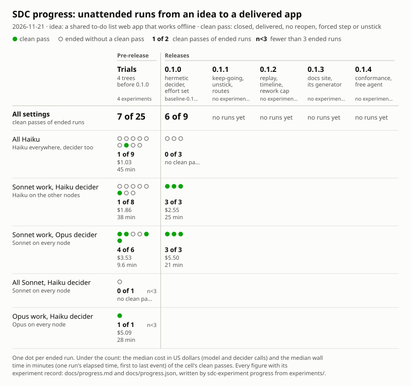

# Progress

Written by `sdc-experiment progress` from `experiments/releases.yaml`, the experiment records `experiments/<id>.yaml` and their run summaries `experiments/<id>/runs/*.json`; `sdc-experiment check --all` fails when this file, `docs/progress.json` or `docs/img/progress.svg` is stale. Nothing here is written by hand. The loop that adds an entry: `docs/improving.md`.

Every figure counts runs of one input, `todo-app` (sha256 `f384a752a2cb`), started with no person (autonomy A5). A **clean pass** is a run that closed, delivered, and needed no reopen, forced step or unstick (`pass_rule: clean-delivery`, `docs/workflow-metrics.md` § 7). Counts come before rates, and a rate is given only from 3 ended runs. Cost is `run.cost_usd` (model calls and decider calls), wall time `run.wall_s`; both are given over the clean passes as median [min, max] (n). Every figure names the experiment record it comes from. Pre-release trees are the trial trees before the first release; they are no release.

## Summary

| entry | kind | date | tree | tested by | clean passes of ended runs | by setting |
|---|---|---|---|---|---|---|
| [Attempts 1-5](#attempts-1-5) | pre-release | 2026-11-21 | several | `trial-3-attempts` | 0 of 9 | haiku 0 of 5; mixed 0 of 4 |
| [acd6f12](#acd6f12) | pre-release | 2026-11-21 | `acd6f12` | `trial-3-batch-1` | 5 of 8 | haiku 1 of 2; mixed 1 of 2; strong 2 of 2; sonnet 0 of 1; opus 1 of 1 |
| [8db4b93](#8db4b93) | pre-release | 2026-11-21 | `8db4b93` | `trial-3-main-1` | 0 of 4 | haiku 0 of 1; mixed 0 of 1; strong 0 of 2 |
| [1001970](#1001970) | pre-release | 2026-11-21 | `1001970` | `trial-3-main-2` | 2 of 3 | haiku no ended run; mixed 0 of 1; strong 2 of 2 |
| [0.1.0](#010) | release | 2026-11-21 | not tagged yet | no experiment yet | no run | - |

Settings (a run is in a setting when its record's settings have every value of `match`):

| setting | label | note | match |
|---|---|---|---|
| `haiku` | All Haiku | Haiku everywhere, decider too | `decider.model` claude-haiku-5-5, `models.implement.model` claude-haiku-5-5, `models.other.model` claude-haiku-5-5, `models.writer.model` claude-haiku-5-5 |
| `mixed` | Sonnet work, Haiku decider | Haiku on the other nodes | `decider.model` claude-haiku-5-5, `models.implement.model` claude-sonnet-5-5, `models.other.model` claude-haiku-5-5, `models.writer.model` claude-sonnet-5-5 |
| `strong` | Sonnet work, Opus decider | Sonnet on every node | `decider.model` claude-opus-5-5, `models.implement.model` claude-sonnet-5-5, `models.other.model` claude-sonnet-5-5, `models.writer.model` claude-sonnet-5-5 |
| `sonnet` | All Sonnet, Haiku decider | Sonnet on every node | `decider.model` claude-haiku-5-5, `models.implement.model` claude-sonnet-5-5, `models.other.model` claude-sonnet-5-5, `models.writer.model` claude-sonnet-5-5 |
| `opus` | Opus work, Haiku decider | Opus on every node | `decider.model` claude-haiku-5-5, `models.implement.model` claude-opus-5-5, `models.other.model` claude-opus-5-5, `models.writer.model` claude-opus-5-5 |

Limits of every figure:

- No run starts the delivered product and no oracle check runs: a clean pass is a Canon outcome closed by rule, not a product seen working.
- Every run so far used the canon binary of the canon checkout at run time, which no record pins.
- Every run so far is registered retrospectively: the records were written after the runs, so none of them decides anything.

## Attempts 1-5

Pre-release tree, not a release, 2026-11-21. Tree: several (trial/3 at cedd691 to trial/3b at ea2f111, each attempt on a tree with the fixes of the attempt before).

What changed:

| commit | change | effect on run metrics |
|---|---|---|
| `f74c68b` | under autopilot the decider is told it is final (after attempt 1) | not measured: no experiment has tested this change |
| `7f5ef7c` | repeated findings dropped, no re-derivation for own defaults (after attempt 2) | not measured: no experiment has tested this change |
| `37fba0b` | the driver says what sent a spent writer back (after attempt 2) | not measured: no experiment has tested this change |
| `073c173` | what only a later step can meet is not an open condition (after attempt 4) | not measured: no experiment has tested this change |

Tested by, primary metric and verdict:

- [`trial-3-attempts`](../experiments/trial-3-attempts/report.md): no hypothesis, so no primary metric, no before and after, and verdict **descriptive**.

Clean passes of ended runs, all settings: **0 of 9** (`trial-3-attempts`); rate: 0 %.

| setting | experiment | variant | clean passes of ended runs | rate | cost of a clean pass, USD | wall time of a clean pass, s | runs (clean passes in bold) |
|---|---|---|---|---|---|---|---|
| All Haiku | `trial-3-attempts` | haiku | 0 of 5 | 0 % | - | - | trial-3-haiku (stopped: awaiting_authority in IDEA-1.direction), trial-3-haiku-2 (stopped: writer_spent in IDEA-1.list.spec), trial-3-haiku-3 (stopped: rejected_without_rework_path in IDEA-1.app.release), trial-3-haiku-4 (stopped: writer_spent in IDEA-1.todo.list), trial-3-haiku-5 (closed: operating) |
| Sonnet work, Haiku decider | `trial-3-attempts` | mixed | 0 of 4 | 0 % | - | - | trial-3-mixed (stopped: awaiting_authority in IDEA-1.direction), trial-3-mixed-2 (stopped: awaiting_authority in IDEA-1.list.items), trial-3-mixed-3 (closed: not_delivered), trial-3-mixed-4 (stopped: decision_not_takeable in IDEA-1.intake) |

Limits of this measurement:

- Each attempt ran on a different tree: the nine runs are a sequence of defect finds, not samples of one setting.
- `trial-3-attempts` is retrospective: written after its runs, it describes them and decides nothing.
- `trial-3-attempts` ran on 5 trees: its runs are not samples of one tree.
- `trial-3-attempts`, known confound `tree`: every attempt ran on a different tree (see trees); the review step was a program stub on all of them
- `trial-3-attempts`, known confound `decider.adapter`: attempts 2 to 5 set SDC_DECIDER_ADAPTER=claude-cli; attempt 1 did not; run-settings.jsonl does not record it

## acd6f12

Pre-release tree, not a release, 2026-11-21. Tree: `acd6f12` (trial/3b, ea2f111 with fix/attempt5-intake and fix/attempt5-close; the review step was a program stub).

What changed:

| commit | change | effect on run metrics |
|---|---|---|
| `102ce99` | requirement citations checked at write; decisions not refused for faults they did not write | not measured: no experiment has tested this change |
| `83d3cbf` | rule:autopilot closes a terminable root, the decider is not asked | not measured: no experiment has tested this change |

Tested by, primary metric and verdict:

- [`trial-3-batch-1`](../experiments/trial-3-batch-1/report.md): no hypothesis, so no primary metric, no before and after, and verdict **descriptive**.

Clean passes of ended runs, all settings: **5 of 8** (`trial-3-batch-1`); rate: 62 %.

| setting | experiment | variant | clean passes of ended runs | rate | cost of a clean pass, USD | wall time of a clean pass, s | runs (clean passes in bold) |
|---|---|---|---|---|---|---|---|
| All Haiku | `trial-3-batch-1` | haiku | 1 of 2 | none given, n 2 < 3 | 1.03 [1.03, 1.03] (1) | 2709 [2709, 2709] (1) | trial-3-haiku-6 (closed: not_delivered), **trial-3-haiku-7** |
| Sonnet work, Haiku decider | `trial-3-batch-1` | mixed | 1 of 2 | none given, n 2 < 3 | 1.86 [1.86, 1.86] (1) | 2295 [2295, 2295] (1) | trial-3-mixed-5 (closed: not_delivered), **trial-3-mixed-6** |
| Sonnet work, Opus decider | `trial-3-batch-1` | strong | 2 of 2 | none given, n 2 < 3 | 2.96 [2.93, 3.00] (2) | 464 [454, 473] (2) | **trial-3-strong-1**, **trial-3-strong-2** |
| All Sonnet, Haiku decider | `trial-3-batch-1` | sonnet | 0 of 1 | none given, n 1 < 3 | - | - | trial-3-sonnet-1 (stopped: decider_budget_spent in IDEA-1.todo.access) |
| Opus work, Haiku decider | `trial-3-batch-1` | opus | 1 of 1 | none given, n 1 < 3 | 5.09 [5.09, 5.09] (1) | 1662 [1662, 1662] (1) | **trial-3-opus-1** |

Limits of this measurement:

- trial-3-mixed-5 started on 3663770 and was rebuilt in place to acd6f12 during its first round.
- Fewer than 3 ended runs in every setting: no rate is given there and no difference between settings or trees is claimed (`docs/workflow-metrics.md` § 6).
- `trial-3-batch-1` is retrospective: written after its runs, it describes them and decides nothing.
- `trial-3-batch-1`, known confound `max_llm_calls`: trial-3-mixed-5 ran with 90, trial-3-mixed-6 with 150
- `trial-3-batch-1`, known confound `canon`: every run used the canon binary of the canon checkout at run time (run-trial.sh's default), which no record pins

## 8db4b93

Pre-release tree, not a release, 2026-11-21. Tree: `8db4b93` (main at 8db4b93, the first tree on which change.review calls a model).

What changed:

| commit | change | effect on run metrics |
|---|---|---|
| `8f4f7a9` | change.review is a model call of class review, checked by a program (impl/review-node) | not measured: no experiment has tested this change |
| `dfe4a3f` | only writer and implement nodes look up a pending rejection | not measured: no experiment has tested this change |
| `f11d0e2` | the requester agent decides the requester-side classes (not used by these runs) | no run metric affected |
| `a1892e3` | live view layout and stopped runs | no run metric affected |
| `a5dd03f` | planning stories for the canon simulate findings | no run metric affected |
| `8db4b93` | scripted cycle review-no-rework-prompt | no run metric affected |

Tested by, primary metric and verdict:

- [`trial-3-main-1`](../experiments/trial-3-main-1/report.md): no hypothesis, so no primary metric, no before and after, and verdict **descriptive**.

Clean passes of ended runs, all settings: **0 of 4** (`trial-3-main-1`); rate: 0 %.

| setting | experiment | variant | clean passes of ended runs | rate | cost of a clean pass, USD | wall time of a clean pass, s | runs (clean passes in bold) |
|---|---|---|---|---|---|---|---|
| All Haiku | `trial-3-main-1` | haiku | 0 of 1 | none given, n 1 < 3 | - | - | trial-3-haiku-8 (stopped: writer_spent in IDEA-1.list.access) |
| Sonnet work, Haiku decider | `trial-3-main-1` | mixed | 0 of 1 | none given, n 1 < 3 | - | - | trial-3-mixed-7 (stopped: review_invalid in IDEA-1.todo.access) |
| Sonnet work, Opus decider | `trial-3-main-1` | strong | 0 of 2 | none given, n 2 < 3 | - | - | trial-3-strong-3 (stopped: review_invalid in IDEA-1.todo.access), trial-3-strong-4 (stopped: review_invalid in IDEA-1.todo.list) |

Limits of this measurement:

- Three of the four runs stopped at their first review call, whose reply the check could not read: the figures measure that defect, not the workflow.
- Fewer than 3 ended runs in every setting: no rate is given there and no difference between settings or trees is claimed (`docs/workflow-metrics.md` § 6).
- `trial-3-main-1` is retrospective: written after its runs, it describes them and decides nothing.
- `trial-3-main-1`, known confound `adapters.review.adapter`: recorded as claude-cli in the runs with a review model; trial-3-haiku-8 has no review model and records no review adapter

## 1001970

Pre-release tree, not a release, 2026-11-21. Tree: `1001970` (trial/main-2, main 8db4b93 with fix/review-reply 49b0a87).

What changed:

| commit | change | effect on run metrics |
|---|---|---|
| `49b0a87` | the review class runs on a schema adapter; a run that cannot is refused | not measured: no experiment has tested this change |

Tested by, primary metric and verdict:

- [`trial-3-main-2`](../experiments/trial-3-main-2/report.md): no hypothesis, so no primary metric, no before and after, and verdict **descriptive**.

Clean passes of ended runs, all settings: **2 of 3** (`trial-3-main-2`); rate: 67 %.

| setting | experiment | variant | clean passes of ended runs | rate | cost of a clean pass, USD | wall time of a clean pass, s | runs (clean passes in bold) |
|---|---|---|---|---|---|---|---|
| All Haiku | `trial-3-main-2` | haiku | no ended run | - | - | - | trial-3-haiku-9 (not ended) |
| Sonnet work, Haiku decider | `trial-3-main-2` | mixed | 0 of 1 | none given, n 1 < 3 | - | - | trial-3-mixed-8 (stopped: rework_spent in IDEA-1.todo.access) |
| Sonnet work, Opus decider | `trial-3-main-2` | strong | 2 of 2 | none given, n 2 < 3 | 4.70 [4.05, 5.34] (2) | 822 [677, 967] (2) | **trial-3-strong-5**, **trial-3-strong-6** |

Limits of this measurement:

- Fewer than 3 ended runs in every setting: no rate is given there and no difference between settings or trees is claimed (`docs/workflow-metrics.md` § 6).
- `trial-3-main-2` is retrospective: written after its runs, it describes them and decides nothing.
- `trial-3-main-2`, known confound `canon`: every run used the canon binary of the canon checkout at run time (run-trial.sh's default), which no record pins
- Listed but not ended, so not counted: `trial-3-haiku-9`.

## 0.1.0

Release, 2026-11-21. Tree: not tagged yet; prepared on release/prepare-0.1.0 at 8b3abd4, which holds main 8db4b93, fix/review-reply and the merges below.

What changed:

| commit | change | effect on run metrics |
|---|---|---|
| `f747085` | hermetic claude-cli adapter; every node class has an explicit default effort | not measured: no experiment has tested this change |
| `a43cce9` | reject and cap routes audited; a question reject, a rework allowance, a spec review rework | not measured: no experiment has tested this change |
| `0598a26` | a decision that replaces an answer supersedes it; what a close reads | not measured: no experiment has tested this change |
| `6c7ba78` | trace scope decisions applied; a re-raised finding stops the run | not measured: no experiment has tested this change |
| `f6d23b8` | one bug fix, red first, as its own protocol sdc.bugfix (not run by the to-do idea) | no run metric affected |
| `b48bd78` | workflow-builder skill | no run metric affected |
| `b58a8db` | triage of the 71 canon simulate findings | no run metric affected |
| `babed52` | planning stories for the bug-fix cycle | no run metric affected |
| `fea0936` | scripted cycle decider-input reads the close from autopilot-close-a3 | no run metric affected |
| `4332c03` | scripted cycles read a program's output before grep -q | no run metric affected |
| `5062b2f` | trial 3 report | no run metric affected |
| `6ef7de6` | the release process and one version for the repository | no run metric affected |
| `6bf251a` | 0.1.0 changelog and release notes | no run metric affected |

Tested by: no experiment yet. No run used this tree, so there is no figure for it.

Limits of this measurement:

- No run has used this tree: the baseline on it (n of at least 3 per setting) is the first step of the improvement loop.

## Experiments in no entry

Records of other inputs, of settings across trees, and planned ones. Inconclusive and contradicted verdicts are listed like held ones.

| experiment | kind | tree | purpose | hypothesis | clean passes of ended runs per variant | primary metric per variant, median [min, max] (n) | verdict |
|---|---|---|---|---|---|---|---|
| [`bugfix-seeds-1`](../experiments/bugfix-seeds-1/report.md) | retrospective | several | Run sdc.bugfix (red first, then the fix) unattended on four seeded bugs, once per seed on each model, to see whether each model writes a red test and a fix that passes the gate. | - | haiku 4 of 4; sonnet 4 of 5 | - | descriptive |
| [`decider-haiku-vs-opus`](../experiments/decider-haiku-vs-opus/report.md) | retrospective | several | Whether the decider model changes how often a rejected merge sends a story back to the implementer, read from the trial-3 runs that exist. | With claude-opus-5-5 instead of claude-haiku-5-5 as the decider and the work on claude-sonnet-5-5, the edge story: merge.approve:rejected -> change.implement occurs at least 1 time fewer per run (median count). | haiku 1 of 7; opus 2 of 2 | `edge.story: merge.approve:rejected -> change.implement.count`: haiku 2 [0, 2] (5); opus 0 [0, 0] (2) | inconclusive |
| [`effort-implement-levels`](../experiments/effort-implement-levels/report.md) | prospective | - | Whether more reasoning effort on the implement class lowers how often change.implement is sent back, three runs per level, as the operator described. | With effort high instead of low on the implement class, the looping factor of story/change.implement falls by at least 0.5. | low 0 ended of 0; medium 0 ended of 0; high 0 ended of 0 | `node.story/change.implement.looping_factor`: low -; medium -; high - | planned, no run yet |
| [`small-idea-1`](../experiments/small-idea-1/report.md) | retrospective | acd6f12 | Run a deliberately small idea from idea to close with no person, to see whether the loops of the to-do runs come from the idea's size. | - | haiku 0 of 1; sonnet 0 of 1 | - | descriptive |
| [`work-haiku-vs-sonnet`](../experiments/work-haiku-vs-sonnet/report.md) | retrospective | several | Whether Sonnet on the work nodes lowers change.implement's looping factor against Haiku, read from the trial-3 runs that exist. | With claude-sonnet-5-5 instead of claude-haiku-5-5 on the implement class (the writer and review classes changed with it), the looping factor of story/change.implement falls by at least 0.5. | haiku 1 of 7; sonnet 1 of 7 | `node.story/change.implement.looping_factor`: haiku 2 [1.333, 4.5] (5); sonnet 1.667 [1, 2.5] (5) | inconclusive |
